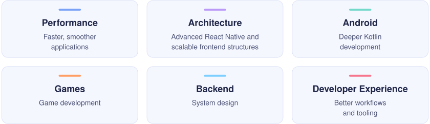

<div align="center">


<a href="https://github.com/lamia-xeon">
  
</a>

[](https://www.linkedin.com/in/lamia-fatiha)
[](mailto:f6lamia@gmail.com)
[](https://github.com/lamia-xeon)

</div>

---

## 👩‍💻 About Me


I'm a software engineer specializing in **mobile, web and game development**, focused on experiences that feel **fast, clean and effortless**.

- 📱 Mobile apps with **React Native**
- 🤖 **Native Android** development with **Kotlin**
- 🌐 Web apps with **React** and **Next.js**
- 📺 **TV application** development
- 🎮 **Game** development

<br clear="right"/>

## 🎯 What I Do

<table>
  <tr>
    <td width="50%" valign="top">
      <h3 align="center">📱 Mobile Development</h3>
      <p align="center">Cross-platform apps with <b>React Native</b> and native Android apps with <b>Kotlin</b>, built for speed and usability.</p>
    </td>
    <td width="50%" valign="top">
      <h3 align="center">🌐 Web Development</h3>
      <p align="center">Modern web apps and dashboards with <b>React</b> and <b>Next.js</b>, built to scale.</p>
    </td>
  </tr>
  <tr>
    <td width="50%" valign="top">
      <h3 align="center">🎮 Game Development</h3>
      <p align="center">Engaging, responsive games with a focus on smooth performance and intuitive play.</p>
    </td>
    <td width="50%" valign="top">
      <h3 align="center">📺 TV Applications</h3>
      <p align="center">Big-screen apps with clear layouts and seamless remote-control navigation.</p>
    </td>
  </tr>
</table>

## 🛠️ Tech Stack

<table>
  <tr>
    <td width="20%"><b>📱 Mobile</b></td>
    <td width="80%">
      
      
      
      
      
    </td>
  </tr>
  <tr>
    <td width="20%"><b>🌐 Web</b></td>
    <td width="80%">
      
      
      
      
      
      
    </td>
  </tr>
  <tr>
    <td width="20%"><b>⚙️ Backend</b></td>
    <td width="80%">
      
      
      
      
      
    </td>
  </tr>
  <tr>
    <td width="20%"><b>🔌 Networking</b></td>
    <td width="80%">
      
      
    </td>
  </tr>
  <tr>
    <td width="20%"><b>🛠️ Tools</b></td>
    <td width="80%">
      
      
      
      
      
    </td>
  </tr>
</table>

<br/>

## 🔭 Current Focus



<br/>


## 🔥 Contribution Activity

<div align="center">
  
</div>

---

<div align="center">

### 🤝 Have an idea worth building? [Let's talk.](mailto:f6lamia@gmail.com)

```bash
git commit -m "Ship fast. Keep architecture clean. Make user experience effortless."
```


</div>
